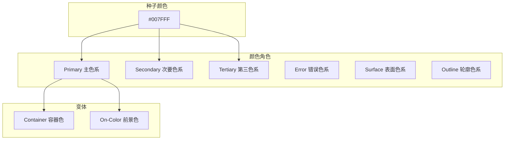
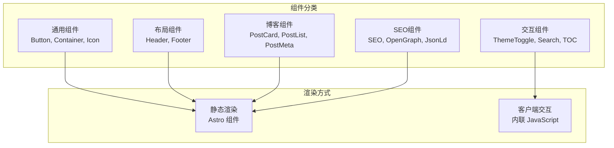
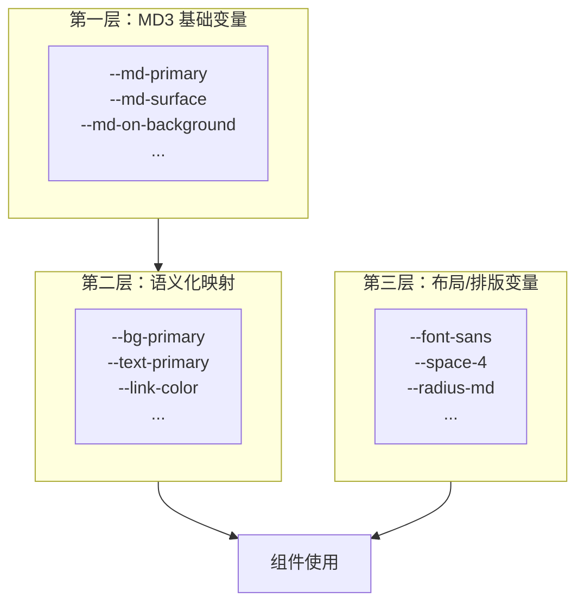
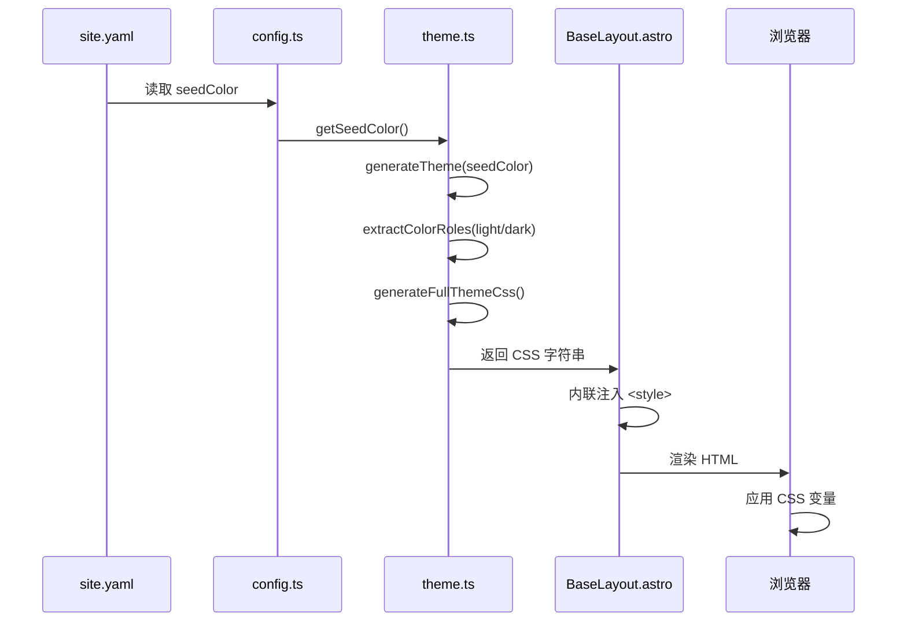
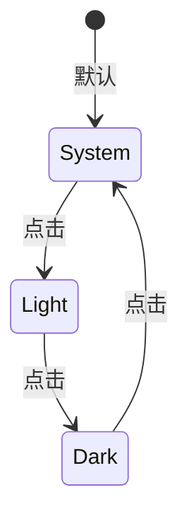
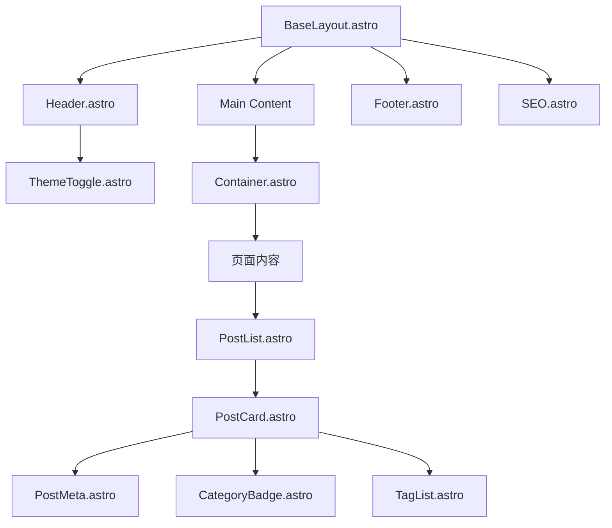
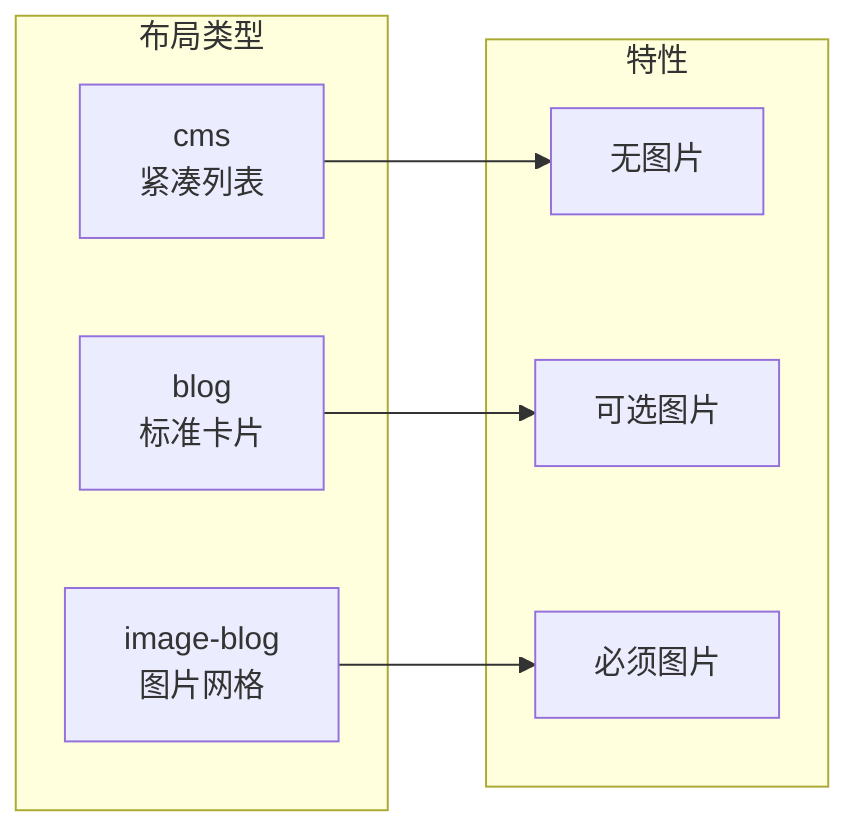
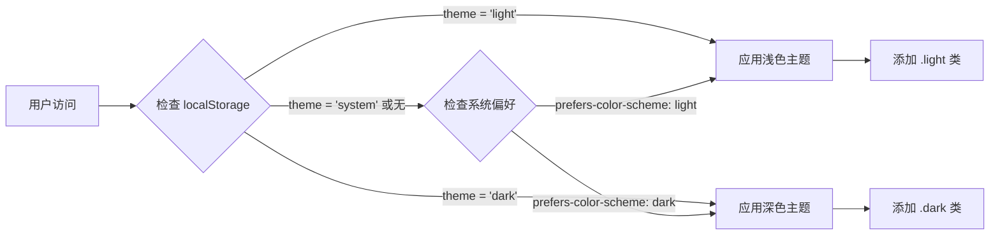
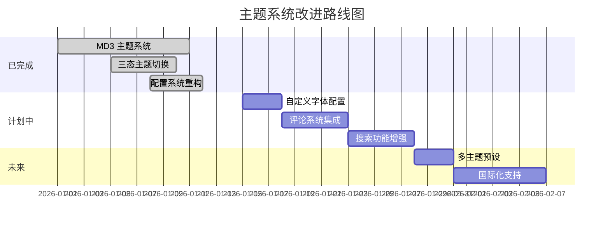

# 主题架构设计文档

## 目录

1. [主题系统概述](#1-主题系统概述)
2. [Material Design 3 集成](#2-material-design-3-集成)
3. [目录结构设计](#3-目录结构设计)
4. [CSS 变量系统](#4-css-变量系统)
5. [主题生成与注入](#5-主题生成与注入)
6. [组件设计](#6-组件设计)
7. [配置系统](#7-配置系统)
8. [深色模式实现](#8-深色模式实现)
9. [后续开发路线图](#9-后续开发路线图)

---

## 1. 主题系统概述

### 1.1 设计目标

- **一致性**：基于 Material Design 3 设计规范，确保整个博客的视觉风格统一
- **可维护性**：通过种子颜色自动生成完整调色板，减少手动维护成本
- **可扩展性**：只需修改一个种子颜色即可生成全新的主题配色
- **性能优先**：利用 Astro 的构建时生成特性，在构建时生成主题 CSS
- **无障碍访问**：MD3 自动确保颜色对比度符合 WCAG 标准

### 1.2 设计原则

1. **MD3 颜色系统**：采用 Material Design 3 的动态颜色系统
2. **种子颜色驱动**：从单一种子颜色生成完整的调色板
3. **三态主题切换**：支持浅色/深色/跟随系统三种模式
4. **构建时生成**：主题 CSS 在构建时生成并内联注入
5. **语义化映射**：MD3 颜色角色映射到语义化变量

### 1.3 技术栈

| 技术 | 用途 |
|------|------|
| `@material/material-color-utilities` | MD3 颜色生成算法 |
| Astro 组件 | 静态组件渲染 |
| YAML 配置 | 站点和主题配置 |
| CSS 变量 | 运行时主题切换 |

---

## 2. Material Design 3 集成

### 2.1 MD3 颜色角色系统

Material Design 3 定义了一套完整的颜色角色系统，从种子颜色自动生成：



### 2.2 颜色角色定义

项目使用的 MD3 颜色角色定义在 [`src/utils/theme.ts`](../src/utils/theme.ts:16)：

```typescript
export interface ColorRoles {
  // Primary 主色系
  primary: string;
  onPrimary: string;
  primaryContainer: string;
  onPrimaryContainer: string;

  // Secondary 次要色系
  secondary: string;
  onSecondary: string;
  secondaryContainer: string;
  onSecondaryContainer: string;

  // Tertiary 第三色系
  tertiary: string;
  onTertiary: string;
  tertiaryContainer: string;
  onTertiaryContainer: string;

  // Error 错误色系
  error: string;
  onError: string;
  errorContainer: string;
  onErrorContainer: string;

  // Background & Surface 背景和表面
  background: string;
  onBackground: string;
  surface: string;
  onSurface: string;
  surfaceVariant: string;
  onSurfaceVariant: string;

  // Outline 轮廓
  outline: string;
  outlineVariant: string;

  // Inverse 反色
  inverseSurface: string;
  inverseOnSurface: string;
  inversePrimary: string;

  // Shadow & Scrim
  shadow: string;
  scrim: string;

  // Surface Tones 表面色调
  surfaceDim: string;
  surfaceBright: string;
  surfaceContainerLowest: string;
  surfaceContainerLow: string;
  surfaceContainer: string;
  surfaceContainerHigh: string;
  surfaceContainerHighest: string;
}
```

### 2.3 Surface Tone 值

根据 MD3 规范，浅色和深色模式使用不同的 tone 值：

| Surface 变体 | 浅色模式 Tone | 深色模式 Tone |
|-------------|--------------|--------------|
| surfaceDim | 87 | 6 |
| surfaceBright | 98 | 24 |
| surfaceContainerLowest | 100 | 4 |
| surfaceContainerLow | 96 | 10 |
| surfaceContainer | 94 | 12 |
| surfaceContainerHigh | 92 | 17 |
| surfaceContainerHighest | 90 | 22 |

---

## 3. 目录结构设计

### 3.1 当前目录结构

```
src/
├── components/
│   ├── blog/                     # 博客专用组件
│   │   ├── BackToList.astro
│   │   ├── CategoryBadge.astro
│   │   ├── PostCard.astro
│   │   ├── PostList.astro
│   │   ├── PostMeta.astro
│   │   ├── PostNavigation.astro
│   │   ├── RelatedPosts.astro
│   │   └── TagList.astro
│   │
│   ├── common/                   # 通用 UI 组件
│   │   ├── Button.astro
│   │   ├── Container.astro
│   │   └── Icon.astro
│   │
│   ├── interactive/              # 交互组件（客户端 JS）
│   │   ├── ImageLightbox.astro
│   │   ├── Search.astro
│   │   ├── TableOfContents.astro
│   │   └── ThemeToggle.astro     # 三态主题切换
│   │
│   ├── layout/                   # 布局组件
│   │   ├── Footer.astro
│   │   └── Header.astro
│   │
│   └── seo/                      # SEO 相关组件
│       ├── index.ts
│       ├── JsonLd.astro
│       ├── OpenGraph.astro
│       ├── schema-helpers.ts
│       ├── SEO.astro
│       └── TwitterCard.astro
│
├── config/
│   ├── site.yaml                 # 站点配置（YAML 格式）
│   └── theme.config.ts           # 主题类型定义
│
├── layouts/
│   ├── BaseLayout.astro          # 基础布局（主题注入）
│   ├── Layout.astro
│   ├── PageLayout.astro
│   └── PostLayout.astro
│
├── styles/
│   └── global.css                # 全局样式（非颜色变量）
│
└── utils/
    ├── config.ts                 # 配置工具函数
    └── theme.ts                  # MD3 主题生成工具
```

### 3.2 组件分类说明



---

## 4. CSS 变量系统

### 4.1 变量分层架构

CSS 变量系统分为三层：



### 4.2 MD3 基础变量（动态生成）

这些变量由 [`src/utils/theme.ts`](../src/utils/theme.ts:198) 在构建时从种子颜色生成：

```css
:root {
  /* Primary 主色系 */
  --md-primary: #0061a4;
  --md-on-primary: #ffffff;
  --md-primary-container: #d1e4ff;
  --md-on-primary-container: #001d36;

  /* Secondary 次要色系 */
  --md-secondary: #535f70;
  --md-on-secondary: #ffffff;
  --md-secondary-container: #d7e3f7;
  --md-on-secondary-container: #101c2b;

  /* Tertiary 第三色系 */
  --md-tertiary: #6b5778;
  --md-on-tertiary: #ffffff;
  --md-tertiary-container: #f2daff;
  --md-on-tertiary-container: #251431;

  /* Error 错误色系 */
  --md-error: #ba1a1a;
  --md-on-error: #ffffff;
  --md-error-container: #ffdad6;
  --md-on-error-container: #410002;

  /* Background & Surface */
  --md-background: #fdfcff;
  --md-on-background: #1a1c1e;
  --md-surface: #fdfcff;
  --md-on-surface: #1a1c1e;
  --md-surface-variant: #dfe2eb;
  --md-on-surface-variant: #43474e;

  /* Outline */
  --md-outline: #73777f;
  --md-outline-variant: #c3c7cf;

  /* Surface Tones */
  --md-surface-dim: #dddde0;
  --md-surface-bright: #fdfcff;
  --md-surface-container-lowest: #ffffff;
  --md-surface-container-low: #f7f6f9;
  --md-surface-container: #f1f0f3;
  --md-surface-container-high: #ebeaed;
  --md-surface-container-highest: #e5e5e8;

  /* Shadow & Scrim */
  --md-shadow: #000000;
  --md-scrim: #000000;
}
```

### 4.3 语义化映射变量

语义化变量映射到 MD3 变量，定义在 [`src/utils/theme.ts`](../src/utils/theme.ts:264)：

```css
:root {
  /* 品牌色 */
  --color-primary: var(--md-primary);
  --color-primary-light: var(--md-primary-container);
  --color-primary-dark: var(--md-primary);

  /* 语义色 */
  --color-success: #10b981;
  --color-warning: #f59e0b;
  --color-error: var(--md-error);
  --color-info: var(--md-primary);

  /* 中性色 - 从 MD3 surface 色调映射 */
  --color-gray-50: var(--md-surface-container-lowest);
  --color-gray-100: var(--md-surface-container-low);
  --color-gray-200: var(--md-surface-container);
  --color-gray-300: var(--md-surface-container-high);
  --color-gray-400: var(--md-outline-variant);
  --color-gray-500: var(--md-outline);
  --color-gray-600: var(--md-on-surface-variant);
  --color-gray-700: var(--md-on-surface);
  --color-gray-800: var(--md-on-background);
  --color-gray-900: var(--md-on-background);

  /* 背景色 */
  --bg-primary: var(--md-background);
  --bg-secondary: var(--md-surface-container-low);
  --bg-tertiary: var(--md-surface-container);
  --bg-inverse: var(--md-inverse-surface);

  /* 文字色 */
  --text-primary: var(--md-on-background);
  --text-secondary: var(--md-on-surface-variant);
  --text-muted: var(--md-outline);
  --text-inverse: var(--md-inverse-on-surface);

  /* 边框色 */
  --border-default: var(--md-outline-variant);
  --border-light: var(--md-surface-container-high);
  --border-dark: var(--md-outline);

  /* 链接色 */
  --link-color: var(--md-primary);
  --link-hover: var(--md-tertiary);

  /* 代码色 */
  --code-bg: var(--md-inverse-surface);
  --code-text: var(--md-inverse-on-surface);
  --code-inline-bg: var(--md-surface-container-high);
  --code-inline-text: var(--md-tertiary);

  /* 标签色 */
  --tag-bg: var(--md-surface-container);
  --tag-text: var(--md-on-surface-variant);
  --tag-hover-bg: var(--md-surface-container-high);
}
```

### 4.4 布局和排版变量

这些变量定义在 [`src/styles/global.css`](../src/styles/global.css:12)，不随主题变化：

```css
:root {
  /* 字体族 */
  --font-sans: -apple-system, BlinkMacSystemFont, 'Segoe UI', Roboto,
    'Helvetica Neue', Arial, 'Noto Sans SC', sans-serif;
  --font-serif: Georgia, 'Times New Roman', 'Noto Serif SC', serif;
  --font-mono: 'Fira Code', 'JetBrains Mono', Consolas, 'Liberation Mono',
    monospace;

  /* 字体大小 */
  --text-xs: 0.75rem;      /* 12px */
  --text-sm: 0.875rem;     /* 14px */
  --text-base: 1rem;       /* 16px */
  --text-lg: 1.125rem;     /* 18px */
  --text-xl: 1.25rem;      /* 20px */
  --text-2xl: 1.5rem;      /* 24px */
  --text-3xl: 1.875rem;    /* 30px */
  --text-4xl: 2.25rem;     /* 36px */
  --text-5xl: 3rem;        /* 48px */

  /* 间距比例（基于 4px 基准） */
  --space-0: 0;
  --space-1: 0.25rem;      /* 4px */
  --space-2: 0.5rem;       /* 8px */
  --space-3: 0.75rem;      /* 12px */
  --space-4: 1rem;         /* 16px */
  --space-5: 1.25rem;      /* 20px */
  --space-6: 1.5rem;       /* 24px */
  --space-8: 2rem;         /* 32px */
  --space-10: 2.5rem;      /* 40px */
  --space-12: 3rem;        /* 48px */
  --space-16: 4rem;        /* 64px */
  --space-20: 5rem;        /* 80px */
  --space-24: 6rem;        /* 96px */

  /* 布局变量 */
  --container-sm: 640px;
  --container-md: 768px;
  --container-lg: 1024px;
  --container-xl: 1280px;
  --container-prose: 65ch;
  --max-width: 800px;

  /* 导航高度 */
  --nav-height: 64px;
  --nav-height-mobile: 56px;

  /* 边框圆角 */
  --radius-sm: 4px;
  --radius-md: 8px;
  --radius-lg: 12px;
  --radius-xl: 16px;
  --radius-full: 9999px;

  /* 阴影 - 使用 MD3 shadow 变量 */
  --shadow-sm: 0 1px 2px 0 color-mix(in srgb, var(--md-shadow) 5%, transparent);
  --shadow-md: 0 4px 6px -1px color-mix(in srgb, var(--md-shadow) 10%, transparent);
  --shadow-lg: 0 10px 15px -3px color-mix(in srgb, var(--md-shadow) 10%, transparent);
  --shadow-xl: 0 20px 25px -5px color-mix(in srgb, var(--md-shadow) 10%, transparent);

  /* 过渡 */
  --transition-fast: 150ms ease;
  --transition-normal: 200ms ease;
  --transition-slow: 300ms ease;

  /* Z-index 层级 */
  --z-dropdown: 100;
  --z-sticky: 200;
  --z-fixed: 300;
  --z-modal-backdrop: 400;
  --z-modal: 500;
  --z-tooltip: 600;
}
```

---

## 5. 主题生成与注入

### 5.1 主题生成流程



### 5.2 主题生成函数

核心生成函数定义在 [`src/utils/theme.ts`](../src/utils/theme.ts:85)：

```typescript
/**
 * 从种子颜色生成 Material Design 3 主题
 * @param seedColor 种子颜色（十六进制格式，如 "#6750A4"）
 * @returns 包含浅色和深色模式的完整调色板
 */
export function generateTheme(seedColor: string): ThemePalette {
  // 将十六进制颜色转换为 ARGB 格式
  const sourceColor = argbFromHex(seedColor);

  // 使用 Material Color Utilities 生成主题
  const theme = themeFromSourceColor(sourceColor);

  return {
    light: extractColorRoles(theme, 'light'),
    dark: extractColorRoles(theme, 'dark'),
  };
}
```

### 5.3 CSS 变量生成

将颜色角色转换为 CSS 变量，定义在 [`src/utils/theme.ts`](../src/utils/theme.ts:198)：

```typescript
/**
 * 将颜色角色转换为 CSS 变量字符串
 * @param colors 颜色角色对象
 * @param prefix CSS 变量前缀（默认为 'md'）
 * @returns CSS 变量字符串
 */
export function colorRolesToCssVariables(
  colors: ColorRoles,
  prefix: string = 'md'
): string {
  const lines: string[] = [];

  // 将 camelCase 转换为 kebab-case
  const toKebabCase = (str: string): string =>
    str.replace(/([a-z])([A-Z])/g, '$1-$2').toLowerCase();

  for (const [key, value] of Object.entries(colors)) {
    const cssVarName = `--${prefix}-${toKebabCase(key)}`;
    lines.push(`  ${cssVarName}: ${value};`);
  }

  return lines.join('\n');
}
```

### 5.4 BaseLayout 中的主题注入

主题 CSS 在 [`src/layouts/BaseLayout.astro`](../src/layouts/BaseLayout.astro:12) 中构建时生成并内联注入：

```astro
---
import { generateFullThemeCss, getSeedColorFromConfig } from '../utils/theme';

// 在构建时生成主题 CSS
const seedColor = getSeedColorFromConfig();
const themeCss = generateFullThemeCss(seedColor);
---

<html>
  <head>
    <!-- Material Design 3 主题 CSS（构建时内联生成） -->
    <style is:inline set:html={themeCss}></style>
  </head>
</html>
```

### 5.5 生成的 CSS 结构

`generateFullThemeCss()` 生成的 CSS 包含以下部分：

```css
/* Material Design 3 主题变量 - 由 #007FFF 生成 */

/* 浅色模式 - MD3 基础变量 */
:root {
  --md-primary: #0061a4;
  --md-on-primary: #ffffff;
  /* ... 其他 MD3 变量 */
}

/* 深色模式 - MD3 基础变量 */
:root.dark {
  --md-primary: #9ecaff;
  --md-on-primary: #003258;
  /* ... 其他 MD3 变量 */
}

/* 系统偏好检测 - MD3 基础变量 */
@media (prefers-color-scheme: dark) {
  :root:not(.light):not(.dark) {
    /* 深色模式变量 */
  }
}

/* 浅色模式 - 语义化映射 */
:root {
  --bg-primary: var(--md-background);
  --text-primary: var(--md-on-background);
  /* ... 其他语义化变量 */
}

/* 深色模式 - 语义化映射 */
:root.dark {
  /* 深色模式语义化变量 */
}

/* 系统偏好检测 - 语义化映射 */
@media (prefers-color-scheme: dark) {
  :root:not(.light):not(.dark) {
    /* 深色模式语义化变量 */
  }
}
```

---

## 6. 组件设计

### 6.1 核心组件列表

| 组件名称 | 类型 | 文件路径 | 职责 |
|---------|------|----------|------|
| BaseLayout | 布局 | `layouts/BaseLayout.astro` | 基础 HTML 结构、主题注入 |
| Header | 布局 | `components/layout/Header.astro` | 网站头部、导航 |
| Footer | 布局 | `components/layout/Footer.astro` | 网站底部、版权 |
| ThemeToggle | 交互 | `components/interactive/ThemeToggle.astro` | 三态主题切换 |
| PostCard | 博客 | `components/blog/PostCard.astro` | 文章卡片展示 |
| PostList | 博客 | `components/blog/PostList.astro` | 文章列表容器 |
| PostMeta | 博客 | `components/blog/PostMeta.astro` | 文章元信息 |
| SEO | SEO | `components/seo/SEO.astro` | 页面 SEO 元信息 |
| Container | 通用 | `components/common/Container.astro` | 内容容器 |
| Button | 通用 | `components/common/Button.astro` | 按钮组件 |

### 6.2 ThemeToggle 组件

三态主题切换组件定义在 [`src/components/interactive/ThemeToggle.astro`](../src/components/interactive/ThemeToggle.astro)：

**支持的模式：**
- `light` - 浅色模式
- `dark` - 深色模式
- `system` - 跟随系统

**组件接口：**

```typescript
interface Props {
  /** 初始主题模式 */
  initialTheme?: 'light' | 'dark' | 'system';
}
```

**切换逻辑：**



**图标显示：**
- 太阳图标 (`material-symbols:light-mode`) - 浅色模式
- 月亮图标 (`material-symbols:dark-mode`) - 深色模式
- 电脑图标 (`material-symbols:computer`) - 跟随系统

### 6.3 组件层级关系



---

## 7. 配置系统

### 7.1 配置文件结构

站点配置使用 YAML 格式，定义在 [`src/config/site.yaml`](../src/config/site.yaml)：

```yaml
# 网站基本信息
site:
  title: 海野味
  description: 分享技术、想法和生活
  author: Your Name
  language: zh-CN
  url: https://example.com

# 博客分类
categories:
  - slug: tech
    name: 技术
    description: 技术相关文章
    color: "#3b82f6"
  - slug: life
    name: 生活
    description: 生活随笔
    color: "#10b981"

# 社交链接
social:
  github: https://github.com/username
  twitter: https://twitter.com/username
  email: email@example.com

# 页脚配置
footer:
  copyright: "©HAIYEWEI.COM 2025. All rights reserved."
  links:
    - name: RSS
      href: /rss.xml
    - name: 站点地图
      href: /sitemap.xml

# 功能开关
features:
  darkMode: true
  search: true
  comments: false
  analytics: false

# 帖子显示配置
posts:
  layout: "blog"           # cms | blog | image-blog
  showImage: false
  postsPerPage: 10
  excerptLength: 150

# Hero 区域配置
hero:
  enabled: true
  title: ""
  subtitle: ""
  background: ""
  showScrollIndicator: true

# 作者配置
authors:
  - id: "admin"
    name: "管理员"
    email: "admin@example.com"
    bio: "网站管理员"

# 主题配置
theme:
  seedColor: "#007FFF"
```

### 7.2 配置类型定义

配置类型定义在 [`src/utils/config.ts`](../src/utils/config.ts:9)：

```typescript
/** 网站基本信息 */
export interface SiteInfo {
  title: string;
  description: string;
  author: string;
  language: string;
  url: string;
}

/** 主题配置 */
export interface ThemeSettings {
  /** 种子颜色 - Material Design 3 会从这个颜色生成完整的调色板 */
  seedColor: string;
}

/** 帖子布局类型 */
export type PostLayout = 'cms' | 'blog' | 'image-blog';

/** 帖子显示配置 */
export interface PostsConfig {
  /** 布局样式 */
  layout: PostLayout;
  /** 是否显示封面图片 */
  showImage: boolean;
  /** 每页显示数量 */
  postsPerPage: number;
  /** 摘要长度（字符数） */
  excerptLength: number;
}

/** Hero 区域配置 */
export interface HeroConfig {
  /** 是否启用 hero 区域 */
  enabled: boolean;
  /** 可选标题 */
  title?: string;
  /** 可选副标题 */
  subtitle?: string;
  /** 可选背景图片 URL */
  background?: string;
  /** 是否显示向下滚动指示器 */
  showScrollIndicator?: boolean;
}

/** 作者配置 */
export interface Author {
  /** 作者唯一标识 */
  id: string;
  /** 作者名称 */
  name: string;
  /** 邮箱地址 */
  email?: string;
  /** 头像 URL */
  avatar?: string;
  /** 作者简介 */
  bio?: string;
}
```

### 7.3 配置工具函数

[`src/utils/config.ts`](../src/utils/config.ts) 提供了一系列工具函数来访问配置：

| 函数名 | 返回类型 | 描述 |
|--------|----------|------|
| `getSiteInfo()` | `SiteInfo` | 获取网站基本信息 |
| `getNavigation()` | `NavLink[]` | 获取导航链接列表 |
| `getCategories()` | `Category[]` | 获取所有分类 |
| `getCategory(slug)` | `Category \| undefined` | 根据 slug 获取分类 |
| `getCategoryName(slug)` | `string` | 获取分类名称 |
| `getCategoryColor(slug)` | `string` | 获取分类颜色 |
| `getSocialLinks()` | `SocialLinks` | 获取社交链接 |
| `getFooterConfig()` | `FooterConfig` | 获取页脚配置 |
| `getFeatures()` | `Features` | 获取功能开关 |
| `isFeatureEnabled(feature)` | `boolean` | 检查功能是否启用 |
| `getCopyright()` | `string` | 获取版权信息 |
| `getThemeSettings()` | `ThemeSettings` | 获取主题配置 |
| `getSeedColor()` | `string` | 获取种子颜色 |
| `getPostsConfig()` | `PostsConfig` | 获取帖子显示配置 |
| `getPostLayout()` | `PostLayout` | 获取帖子布局类型 |
| `shouldShowPostImage()` | `boolean` | 检查是否显示帖子图片 |
| `getPostsPerPage()` | `number` | 获取每页帖子数量 |
| `getExcerptLength()` | `number` | 获取摘要长度 |
| `getHeroConfig()` | `HeroConfig` | 获取 Hero 区域配置 |
| `isHeroEnabled()` | `boolean` | 检查 Hero 区域是否启用 |
| `getAuthors()` | `Author[]` | 获取所有作者 |
| `getAuthorById(id)` | `Author \| undefined` | 根据 ID 获取作者 |
| `getAuthorName(id)` | `string` | 获取作者名称 |
| `getDefaultAuthor()` | `Author \| undefined` | 获取默认作者 |

### 7.4 帖子布局系统

项目支持三种帖子布局样式：

| 布局类型 | 描述 | 图片显示 |
|----------|------|----------|
| `cms` | 紧凑的列表样式，适合内容管理系统风格 | 不显示 |
| `blog` | 标准博客卡片样式 | 可配置 |
| `image-blog` | 以图片为主的瀑布流/网格样式 | 始终显示 |



---

## 8. 深色模式实现

### 8.1 三态切换方案

项目支持三种主题模式：



### 8.2 防闪烁脚本

在 [`src/layouts/BaseLayout.astro`](../src/layouts/BaseLayout.astro:95) 中，使用内联脚本防止主题闪烁：

```html
<!-- 防闪烁脚本：在页面渲染前应用正确的主题 -->
<script is:inline>
  (function() {
    const theme = localStorage.getItem('theme');
    const systemDark = window.matchMedia('(prefers-color-scheme: dark)').matches;
    
    if (theme === 'dark' || (theme === 'system' && systemDark) || (!theme && systemDark)) {
      document.documentElement.classList.add('dark');
    } else if (theme === 'light') {
      document.documentElement.classList.add('light');
    }
  })();
</script>
```

### 8.3 CSS 选择器策略

主题 CSS 使用以下选择器策略：

```css
/* 浅色模式 - 默认 */
:root {
  --md-primary: #0061a4;
  /* ... */
}

/* 深色模式 - 用户手动选择 */
:root.dark {
  --md-primary: #9ecaff;
  /* ... */
}

/* 系统偏好检测 - 用户选择跟随系统或未设置 */
@media (prefers-color-scheme: dark) {
  :root:not(.light):not(.dark) {
    --md-primary: #9ecaff;
    /* ... */
  }
}
```

### 8.4 ThemeToggle 实现细节

主题切换逻辑定义在 [`src/components/interactive/ThemeToggle.astro`](../src/components/interactive/ThemeToggle.astro:85)：

```typescript
type ThemeMode = 'light' | 'dark' | 'system';
const STORAGE_KEY = 'theme';
const MODES: ThemeMode[] = ['light', 'dark', 'system'];

/**
 * 应用主题到 document
 */
function applyTheme(mode: ThemeMode): void {
  const resolved = resolveTheme(mode);
  const root = document.documentElement;
  
  // 设置 data-theme 属性用于图标显示
  root.setAttribute('data-theme', mode);
  
  // 设置 class 用于样式
  root.classList.remove('light', 'dark');
  root.classList.add(resolved);
}

// 监听系统主题变化
const mediaQuery = window.matchMedia('(prefers-color-scheme: dark)');
mediaQuery.addEventListener('change', () => {
  if (currentMode === 'system') {
    applyTheme('system');
  }
});
```

---

## 9. 后续开发路线图

### 9.1 已完成功能

- [x] Material Design 3 主题系统集成
- [x] 种子颜色驱动的调色板生成
- [x] 三态主题切换（浅色/深色/系统）
- [x] 构建时主题 CSS 生成
- [x] 防闪烁脚本
- [x] YAML 配置系统
- [x] 帖子布局系统（cms/blog/image-blog）
- [x] Hero 区域配置
- [x] 作者系统
- [x] Expressive Code 样式集成
- [x] SEO 组件
- [x] 基础布局组件

### 9.2 计划中功能

| 功能 | 优先级 | 描述 |
|------|--------|------|
| 自定义字体配置 | 中 | 支持在配置中指定自定义字体 |
| 多主题预设 | 低 | 提供多个预设的种子颜色方案 |
| 动态主题切换 | 低 | 运行时更换种子颜色 |
| 评论系统集成 | 中 | 集成 Giscus 或其他评论系统 |
| 搜索功能增强 | 中 | 全文搜索支持 |
| 国际化支持 | 低 | 多语言支持 |

### 9.3 架构改进计划



---

## 附录

### A. 参考资源

- [Material Design 3 Color System](https://m3.material.io/styles/color/overview)
- [Material Color Utilities](https://github.com/material-foundation/material-color-utilities)
- [Astro 文档](https://docs.astro.build/)
- [CSS Custom Properties](https://developer.mozilla.org/en-US/docs/Web/CSS/Using_CSS_custom_properties)

### B. 相关文件索引

| 文件 | 描述 |
|------|------|
| [`src/utils/theme.ts`](../src/utils/theme.ts) | MD3 主题生成工具 |
| [`src/utils/config.ts`](../src/utils/config.ts) | 配置工具函数 |
| [`src/config/site.yaml`](../src/config/site.yaml) | 站点配置文件 |
| [`src/styles/global.css`](../src/styles/global.css) | 全局样式 |
| [`src/layouts/BaseLayout.astro`](../src/layouts/BaseLayout.astro) | 基础布局（主题注入） |
| [`src/components/interactive/ThemeToggle.astro`](../src/components/interactive/ThemeToggle.astro) | 主题切换组件 |

### C. 颜色角色速查表

| MD3 变量 | 用途 | 浅色示例 | 深色示例 |
|----------|------|----------|----------|
| `--md-primary` | 主要操作、强调 | #0061a4 | #9ecaff |
| `--md-on-primary` | 主色上的文字 | #ffffff | #003258 |
| `--md-primary-container` | 主色容器背景 | #d1e4ff | #004880 |
| `--md-secondary` | 次要操作 | #535f70 | #bbc7db |
| `--md-tertiary` | 第三强调色 | #6b5778 | #d6bee4 |
| `--md-error` | 错误状态 | #ba1a1a | #ffb4ab |
| `--md-background` | 页面背景 | #fdfcff | #1a1c1e |
| `--md-surface` | 组件表面 | #fdfcff | #1a1c1e |
| `--md-outline` | 边框、分隔线 | #73777f | #8d9199 |